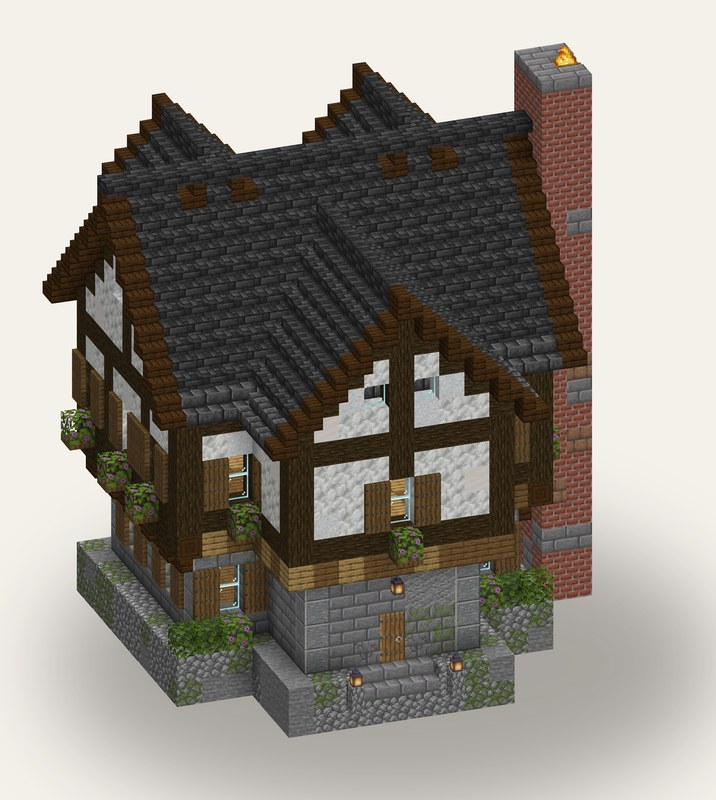

# mcbuilder

Build Minecraft structures from Python. Write a short script, and mcbuilder:

1. **validates** every block against the real block registry of your Minecraft version,
2. **renders previews** with the real vanilla models and textures, so you (or an AI agent) can
   look at the result and iterate,
3. **exports** a structure-block `.nbt` you can paste with a structure block, Litematica or a
   server plugin,
4. **writes a build guide**: a top-down plan for every layer plus material lists, for building by
   hand in survival,
5. **imports** an existing `.nbt` back into a readable script, to study or remix someone's build.

It is designed for AI agents as much as for people: one obvious way to do each thing, errors that
point at the line of your script, and previews you can actually check.



## Install

```bash
pip install mcbuilder            # Python 3.10+
mcbuild assets fetch --version 26.2   # once: block registry + vanilla textures
```

## Thirty seconds

```python
# hut.py
import mcbuilder as mb

BUILD = mb.Build(seed=1)

with BUILD:
    BUILD.box((0, 0, 0), (6, 0, 4), "minecraft:cobblestone")
    BUILD.walls((0, 1, 0), (6, 3, 4), "minecraft:oak_planks")
    BUILD.roof_gable((-1, 4, -1), (7, 4, 5), "minecraft:spruce_stairs", ridge="x")
```

```bash
mcbuild check hut.py                    # validate (fast)
mcbuild run hut.py --preview --guide    # previews + hut.nbt + layer guide in dist/run-001/
```

## For AI agents

- Read [the API reference](docs/api.md) once; it fits in a page.
- Loop on `mcbuild check` (under a second), then `mcbuild run --preview`, and look at the images.
- Use `--focus` close-ups on big builds and `--tier trusted` to check every `facing`.
- Shapes return what they placed: size the next part from `geo.bounds()` instead of doing the
  arithmetic.

## Documentation

| | |
|---|---|
| [Getting started](docs/getting-started.md) | install, first build, the check → preview → iterate loop |
| [API reference](docs/api.md) | `Build`, shapes, materials, `Geometry`, reading a build back |
| [Blocks and directions](docs/blocks.md) | block strings, `facing`/`axis`, coordinates, rotation |
| [Previews](docs/previews.md) | render tiers, camera views, close-ups |
| [CLI](docs/cli.md) | every command and flag, `report.json`, `.nbt` export, build guides |
| [Design guide (draft)](docs/design-draft.md) | medieval timber-frame techniques measured from expert builds; provisional |

Examples live in [`examples/`](examples/): a storehouse (the design guide's test build), a
homestead (house, barn, watchtower, well), an underwater base, a floating observatory and a set of
small waystones.

## License

MIT, see [LICENSE](LICENSE). Minecraft assets are never bundled; `mcbuild assets fetch`
downloads them from Mojang onto your machine.
