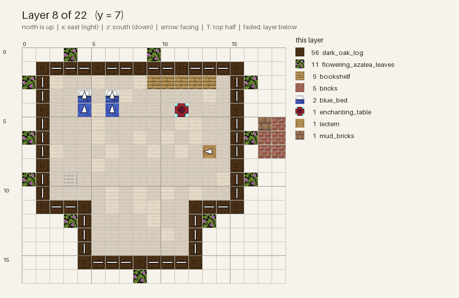

# Getting started

## 1. Install

```bash
pip install mcbuilder        # Python 3.10+
```

mcbuilder checks blocks against the real registry of a Minecraft version and renders with the
real vanilla textures. Download both once (they go to `~/.cache/mcbuilder/<version>/`; nothing
from Mojang is bundled with the package):

```bash
mcbuild assets fetch --version 26.2
```

Put an `mcbuild.toml` next to your scripts to pin the version your server runs:

```toml
mc_version = "26.2"
```

## 2. Your first build

`mcbuild init` writes this starter script to `house.py`:

```python
# house.py: starter build written by `mcbuild init`.
#
# Loop:  mcbuild check house.py   ->   mcbuild run house.py --preview
# Look at the previews, change numbers, run again.
import mcbuilder as mb

BUILD = mb.Build(seed=1, views="iso;az225_el025;top")

WALL = mb.patches([("minecraft:oak_planks", 3), "minecraft:stripped_oak_wood"], scale=3)

with BUILD:
    # 7 x 5 footprint: cobblestone floor, plank walls 3 high
    BUILD.box((0, 0, 0), (6, 0, 4), "minecraft:cobblestone")
    BUILD.walls((0, 1, 0), (6, 3, 4), WALL)
    for x, z in ((0, 0), (6, 0), (0, 4), (6, 4)):
        BUILD.pillar((x, 1, z), 3, "minecraft:oak_log[axis=y]")

    # door (north wall) and a window (south wall)
    BUILD.set(3, 1, 0, "minecraft:oak_door[facing=north,half=lower,hinge=left]")
    BUILD.set(3, 2, 0, "minecraft:oak_door[facing=north,half=upper,hinge=left]")
    BUILD.box((2, 2, 4), (4, 2, 4), "minecraft:glass_pane")

    # gable roof with a 1-block overhang; shapes return what they placed,
    # so the chimney can be sized from the roof's real peak
    roof = BUILD.roof_gable((-1, 4, -1), (7, 4, 5), "minecraft:spruce_stairs",
                            ridge="x", verge="minecraft:dark_oak_stairs")
    (_, _, _), (_, peak, _) = roof.bounds()
    BUILD.box((5, 1, 3), (5, peak + 1, 3), "minecraft:cobblestone")
```

What it shows:

- A script defines a module-level `BUILD` and places blocks inside `with BUILD:`.
- `box`, `walls`, `pillar` and `roof_gable` are *shapes*; every shape is a `BUILD` method that
  places blocks and returns what it placed, so `roof.bounds()` gives the real roof peak.
- `mb.patches([...])` mixes block variants in natural-looking patches instead of one flat
  material.
- Stairs on a roof get their `facing` computed for you. Everywhere else, blocks are placed
  exactly as written.

## 3. The loop

```bash
mcbuild check house.py                 # validate: under a second
mcbuild run house.py --preview         # previews + house.nbt in dist/run-001/
```

```
house.py — OK (165 blocks, 11 types, 0 errors, 0 warnings)
```

Open `dist/run-001/previews_faithful/*.png`, change numbers, run again. Each run gets a new
`run-NNN` folder; `mcbuild diff run-001 run-002` lists what changed.

When something is wrong, the error names the line of *your* script:

```
house.py — FAILED (165 blocks, 11 types, 1 errors, 0 warnings)
  error: unknown block 'minecraft:cobblestones' (not in the 26.2 registry) (at house.py:13) — did you mean minecraft:cobblestone or minecraft:cobblestone_slab or minecraft:cobblestone_stairs?
```

## 4. Look closer

- `--views "iso;az200_el025;top"` picks camera angles ([previews](previews.md)).
- `--focus -10,0,-14:2,12,-6` renders only that box: a close-up of one part of a big build.
- `--tier trusted` draws stairs, logs and other directional blocks as simple shapes, which is
  the quickest way to check that every `facing` and `axis` is right.

## 5. Use it in the game

- **Paste**: `dist/run-NNN/house.nbt` is a vanilla structure file. Load it with a structure
  block (put it in `<world>/generated/minecraft/structures/`), Litematica or a server plugin.
- **Build by hand**: `mcbuild run house.py --guide` adds `guide/guide.md`, which has the material
  list and a top-down plan for every layer:



## Next

- [API reference](api.md): every shape and method.
- [Blocks and directions](blocks.md): block strings, `facing`, coordinates.
