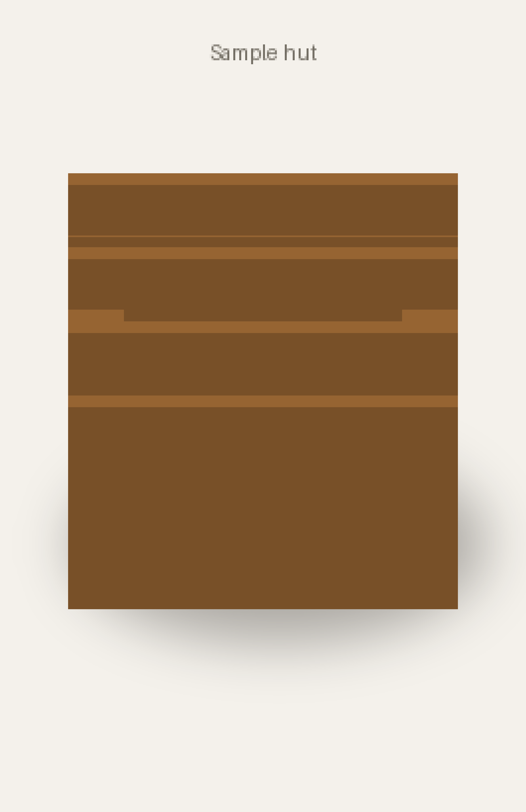
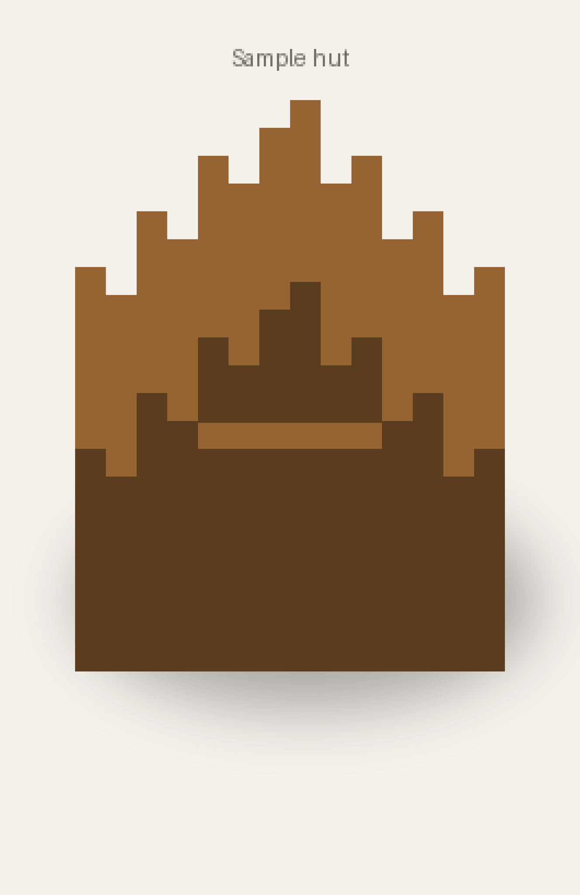
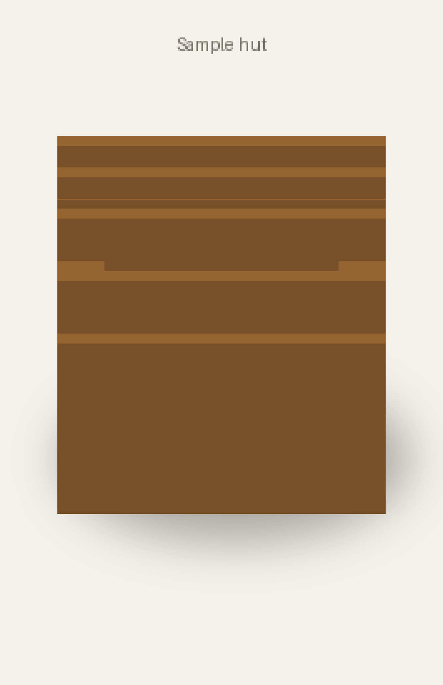
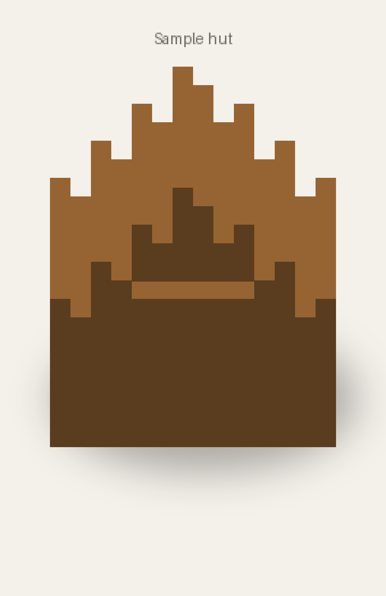
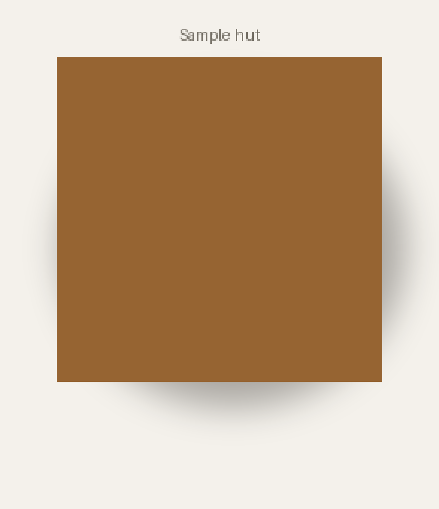
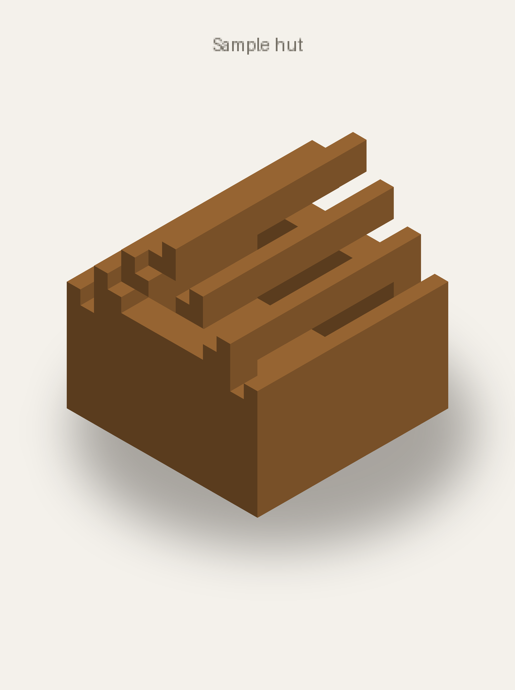

# Previews

```bash
mcbuild run house.py --preview                       # faithful tier, the script's views
mcbuild run house.py --preview --views "iso;top"     # pick cameras
mcbuild run house.py --preview --focus -10,0,-14:2,12,-6   # close-up of one box
mcbuild run house.py --preview --tier trusted        # check every facing/axis
```

From Python: `BUILD.render("out/", views="iso", tier="faithful", region=((x0, y0, z0), (x1, y1, z1)))`.

## Tiers

| `--tier` | Folder | Looks like | Use it to |
|---|---|---|---|
| `faithful` (default) | `previews_faithful/` | real vanilla block models and textures, soft shadow, title | judge how the build looks; final check |
| `trusted` | `previews_trusted/` | simple flat-colored shapes: stairs as wedges, axis bands on logs, plates for doors and trapdoors | verify every `facing`, `axis` and `half` before pasting |
| `fast` | `previews/` | textured full cubes | a quick look at massing; **never** trust directions here |
| `all` | all three | | |

Blocks a tier cannot draw correctly become magenta cubes and add one warning per block type to
the run output and `report.json`. Those blocks still export fine; only the preview is uncertain.

The trusted tier gives each block type its own vivid color, so builds with many block types turn
into camouflage. Use `--focus` to check one part at a time.

## Views

A view is a camera angle. Separate several with `;`.

| Token | Meaning |
|---|---|
| `az<deg>_el<deg>` | azimuth clockwise from north, elevation above the horizon: `az045_el025` looks from the north-east, 25° up |
| `orbit<n>_el<deg>` | `n` views evenly around the build, starting at north: `orbit8_el25` |
| `top` | straight down |
| `iso` | `az045_el035` |

Resolution order: `--views` on the command line, then `Build(views=...)` in the script, then the
default `orbit8_el25;top` (9 views). `--count N` adds an `N`-view orbit. At most 36 views per
run.

Which side you see: azimuth 0 looks from the north (you see the north faces), 90 from the east,
180 from the south, 270 from the west. To see a south-facing front door, use something like
`az200_el025`.

| | |
|---|---|
|  `az000_el025` from the north |  `az090_el025` from the east |
|  `az180_el025` from the south |  `az270_el025` from the west |
|  `top` |  `iso` |

## Close-ups

On a large build a single block is only a few pixels wide. `--focus x0,y0,z0:x1,y1,z1` renders
only the blocks inside that box (in script coordinates); the `.nbt` and build guide still cover
the whole build. Use it to inspect a doorway, a roof corner or one building of a group.

## Interiors

Previews show the outside. To check an interior, focus on a box that stops below the ceiling,
for example `--focus -10,0,-14:2,5,-6` for the ground floor of a house whose walls end at y = 5.
